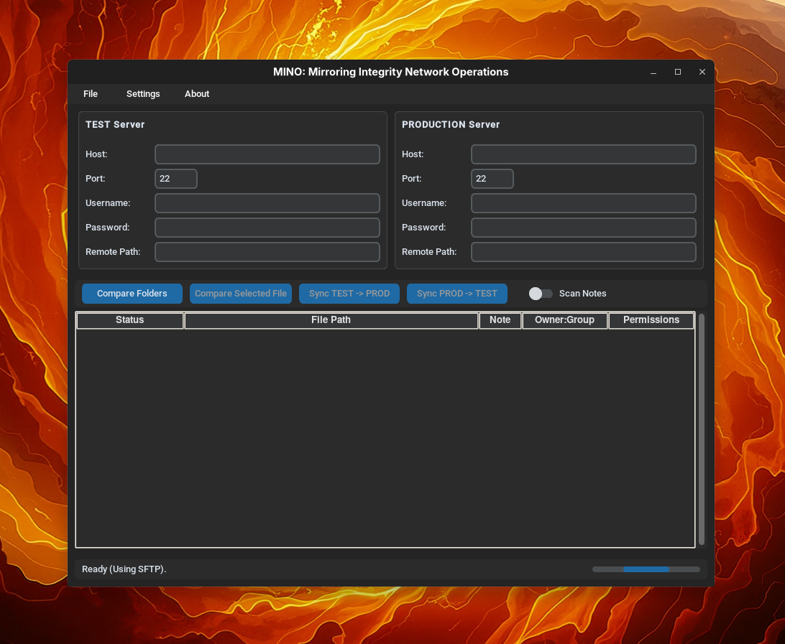

# MINO: Mirroring Integrity Network Operations

MINO is a powerful and intuitive desktop application designed to facilitate the synchronization and management of files between a **TEST** environment and a **PRODUCTION** environment. Originally built for SFTP, MINO now seamlessly supports combining **Local** and **Remote (SFTP)** folders. It provides a visual interface to compare directories, identify differences, and synchronize changes with confidence.



## What's New
* **Bidirectional Sync:** You can now synchronize files not just from TEST to PROD, but also in reverse (`PROD -> TEST`).
* **Local Folder Support:** Set the Host to `local` to sync directly with directories on your machine, enabling Local-to-Local or Local-to-Remote workflows.
* **Custom Ignore Patterns & Keywords:** The `MINO` scan keyword is now fully customizable, and you can define custom ignore patterns (e.g., `*.tmp`, `node_modules`).

## Features

*   **Dual-Pane Comparison**: Visually compare the contents of two environments side-by-side (Local or SFTP).
*   **Hash-Based Verification**: Uses MD5 hashing to ensure file integrity and accurately detect changes, even if timestamps differ.
*   **Selective Synchronization**:
    *   **Batch Sync (Bidirectional)**: Synchronize selected files or entire folders between TEST and PROD environments. 
    *   **Context Menu Sync**: Right-click to sync individual files or multiple selections dynamically based on their status.
*   **Integrated Editor (WIP)**: Edit files directly within the application and save changes back to the server. *Note: The editor is currently a Work In Progress and new features are being developed.*
*   **Diff Viewer**: View line-by-line differences between files on TEST and PROD to review code changes before syncing.
*   **Backup System**:
    *   **Remote Backup**: Create a backup copy of the production folder on the remote server itself before syncing.
    *   **Local Backup**: Download a backup of the production folder to your local machine.
*   **Workspace Management**: Save and load server configurations (Host, Port, User, Path, etc.) to quickly switch between projects. Includes secure credential support.
*   **Attribute Management**: View and visually modify file permissions (chmod) and ownership (chown), using the actual users/groups polled from the remote system.
*   **Keyword Scanning**: Leave notes for yourself directly inside your code. By adding your custom keyword (default `MINO`) anywhere in a file's content, the application will flag it with a warning icon (⚠) during comparison.

## Installation

1.  Clone the repository:
    ```bash
    git clone https://github.com/Negatorto/mino.git
    cd mino
    ```

2.  Install the required dependencies:
    ```bash
    pip install -r requirements.txt
    ```

## Usage

1.  Run the application using the new entry point:
    ```bash
    python mino.py
    ```

2.  **Configure Environments**:
    *   Enter the connection details for both the **TEST Server** (Source) and **PRODUCTION Server** (Destination).
    *   *Tip:* Set the Host to `local` and leave Port/User/Pass empty to target a local folder pathway instead of an SFTP server.

3.  **Compare**:
    *   Click **"Compare Folders"** to scan both environments and see the differences.
    *   Files will be listed with their status: `IDENTICAL`, `DIFFERENT`, `ONLY ON TEST`, or `ONLY ON PROD`.

4.  **Synchronize**:
    *   **Full Sync**: Click **"Sync TEST -> PROD"** or **"Sync PROD -> TEST"** to open the synchronization window. You can choose to backup the destination first and whether to delete files that are only on the target.
    *   **Selected Files**: Multi-select files, right-click, and choose the appropriate Sync option from the context menu.

5.  **Edit & Diff**:
    *   Select a file and click **"Compare Selected File"** (or right-click) to view content differences side-by-side.
    *   In the Diff window, use the **"Edit TEST"** or **"Edit PROD"** buttons to modify files directly via the built-in editor.

## Requirements

*   Python 3.x
*   `customtkinter`
*   `paramiko`

## License

This project is licensed under the **GNU General Public License v3.0**.
See the [LICENSE](LICENSE) file for details. ♥️

